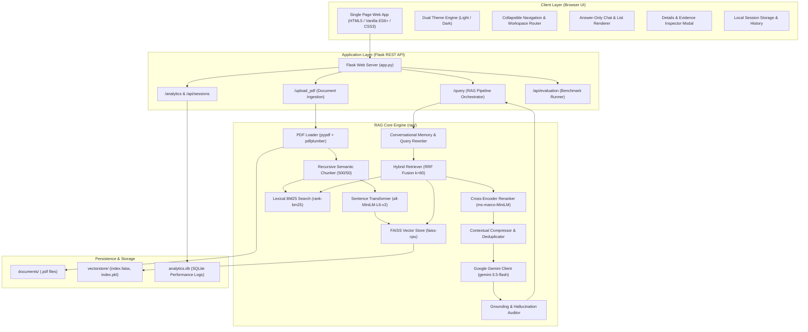
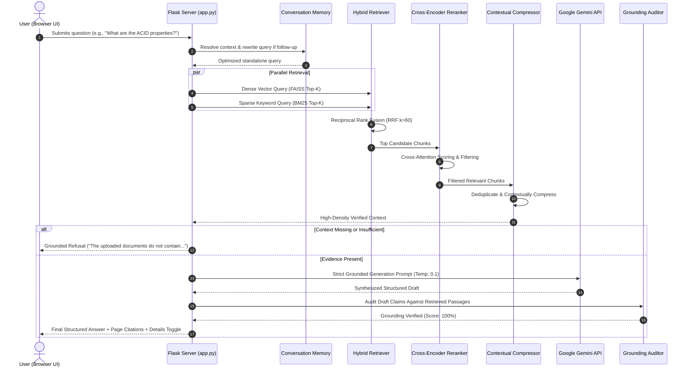

# Intelligent Document Question Answering System Using RAG

A production-grade, document-grounded Retrieval-Augmented Generation (RAG) system built with **Python**, **Flask**, **FAISS**, **BM25**, **Sentence Transformers**, **Cross-Encoder Reranking**, and the **Google Gemini API**.

[](https://www.python.org/)
[](https://flask.palletsprojects.com/)
[](https://github.com/facebookresearch/faiss)
[](https://ai.google.dev/)
[-brightgreen.svg)]()

---

## Table of Contents

1. [Project Overview](#1-project-overview)
2. [Problem Statement](#2-problem-statement)
3. [Objectives](#3-objectives)
4. [Main Features](#4-main-features)
5. [Technology Stack](#5-technology-stack)
6. [System Architecture](#6-system-architecture)
7. [RAG Workflow](#7-rag-workflow)
8. [Installation Instructions](#8-installation-instructions)
9. [Environment Setup](#9-environment-setup)
10. [Application Startup Instructions](#10-application-startup-instructions)
11. [Public Deployment on Render](#11-public-deployment-on-render)
12. [Evaluation and Testing](#12-evaluation-and-testing)
13. [Known Limitations](#13-known-limitations)
14. [Future Improvements](#14-future-improvements)

---

## 1. Project Overview

The **Intelligent Document Question Answering System Using RAG** is an end-to-end information retrieval and synthesis application engineered for accurate, verifiable, and hallucination-resistant Q&A over complex PDF documents. 

Unlike conventional language models that answer strictly from static parametric weights, this system retrieves relevant evidence from indexed PDF documents, reranks candidate passages with cross-attentional neural models, compresses retrieved contexts, synthesizes grounded answers using Google Gemini, and rigorously validates claims against source material before presenting the answer to the user.

The system is equipped with an interactive, responsive web workspace featuring an answer-only chat interface, multi-document selection counters, balanced comparison retrieval, conversational memory, session management, an audit history trail, an analytics dashboard, and a dual-theme visual system (Light and Dark).

---

## 2. Problem Statement

In academic, technical, and enterprise environments, knowledge workers frequently interact with lengthy, information-dense PDF documents such as textbooks, technical specifications, and research reports. Traditional approaches suffer from critical shortcomings:

1. **Manual Inefficiency:** Manually scanning, searching keywords, or reading through hundreds of PDF pages to locate specific answers is slow and error-prone.
2. **LLM Hallucinations:** Direct querying of standard Large Language Models often produces plausible-sounding but factually fabricated statements when answering domain-specific or private questions.
3. **Context Window Limitations:** Passing entire multi-hundred-page documents directly into LLM prompts exceeds context window constraints and incurs substantial latency and financial costs.
4. **Keyword vs. Semantic Mismatch:** Pure keyword search (e.g., standard Ctrl+F) fails to understand conceptual queries, while pure semantic vector search often overlooks exact technical codes, formulas, or acronyms.
5. **Document Starvation in Comparisons:** In multi-document comparisons, larger or denser documents can monopolize top-k retrieval results, preventing balanced representation across all compared sources.

This project resolves these challenges by combining hybrid dense-sparse retrieval, neural cross-encoder reranking, balanced multi-document candidate allocation, and automated hallucination verification.

---

## 3. Objectives

The primary objectives of this system are:

- **Strict Document Grounding:** Ensure 100% of generated responses are supported by the retrieved document evidence, returning explicit, safe fallback refusals when information is absent.
- **High Retrieval Accuracy:** Maximize retrieval precision by uniting semantic vector search (**FAISS**) with lexical keyword retrieval (**Okapi BM25**), re-scored via deep neural cross-encoder reranking.
- **Fair Multi-Document Comparisons:** Implement balanced per-document retrieval quotas to eliminate document starvation during comparative inquiries.
- **Conversational Continuity:** Maintain contextual dialogue memory with automated query re-writing to resolve pronouns and ellipsis across turns.
- **User-Centric Visual Design:** Provide a clean, answer-only chat interface with structured markdown formatting (numbered lists, bullet points, bold headers, code snippets), collapsible sidebars, and dual light/dark themes.
- **Automated Verification:** Deliver an integrated evaluation benchmark suite that continuously audits relevance, completeness, document grounding, retrieval quality, and response latency.

---

## 4. Main Features

### Core RAG Pipeline
- **Dual PDF Extraction:** Combines `pypdf` for rapid text stream extraction with `pdfplumber` for structured layout and table parsing.
- **Recursive Chunking:** Splits documents into 500-character chunks with a 50-character semantic overlap, preserving exact page numbers and document filenames.
- **Hybrid Retrieval (Dense + Sparse):** Evaluates semantic similarity using `sentence-transformers/all-MiniLM-L6-v2` in a FAISS index alongside tokenized lexical matching with Rank-BM25, fused via Reciprocal Rank Fusion (RRF).
- **Neural Cross-Encoder Reranking:** Re-scores top-k fused candidates using `cross-encoder/ms-marco-MiniLM-L-6-v2`, filtering out semantically irrelevant noise.
- **Contextual Compression & Deduplication:** Strips redundant whitespace and overlapping content while preserving high-density evidence and exact page metadata.
- **Grounded LLM Generation:** Synthesizes structured answers using the **Google Gemini API** (`gemini-3.5-flash` / `gemini-3.5-flash-lite`) with a low temperature of `0.1` for deterministic factual precision.
- **Automated Claim Verification:** Executes post-generation grounding audits to detect and intercept unsupported claims before delivering answers.
- **Click-to-Verify Page Citations:** Every factual response provides interactive citations displaying the exact source document, page number, and evidence passage.
- **Safe Out-of-Scope Refusal:** Safely declines questions not present in the indexed documents without inventing facts or hallucinating outside sources.

### Multi-Document & Comparison Intelligence
- **Multi-Document Selection Counters:** Select, deselect, or filter individual documents for focused Q&A.
- **Balanced Multi-Document Retrieval:** Guarantees fair candidate quotas across all selected PDFs when comparison queries are detected, preventing single-document bias.

### User Interface & Experience
- **Answer-Only Clean Chat:** Clean, distraction-free conversational workspace that displays the user prompt and the direct, grounded answer.
- **Accurate List Numbering:** Custom markdown post-processor guarantees ordered lists (e.g., ACID properties, SQL JOIN types) render sequentially as `1.`, `2.`, `3.`, `4.` without restarting at `1.`.
- **Details Modal:** Clickable "View Source Details" button opens an inspector modal displaying retrieved context chunks, similarity scores, and execution metadata, with an instant close toggle.
- **Conversational Memory:** Contextual resolution of pronouns and follow-up inquiries across multi-turn chats.
- **Browser-Saved Sessions & Audit History:** Persists chat sessions with search, top pinning, and renaming; maintains a searchable question history trail with re-query shortcuts.
- **Analytics Dashboard:** Real-time metrics tracking query counts, response latencies, grounding rates, and full interaction tables with CSV export.
- **Dual Theme Support:** Seamless toggle between warm Emerald Light Theme and high-contrast Slate/Lime Dark Theme.

---

## 5. Technology Stack

| Layer | Technology | Version | Purpose |
|---|---|---|---|
| **Backend Framework** | Python / Flask | 3.10+ / 3.1.x | Modular REST API, file handling, and session state |
| **Generative LLM** | Google Gemini API | `google-genai` 2.x | High-speed grounded answer synthesis (`gemini-3.5-flash`) |
| **Embeddings** | Sentence Transformers | `all-MiniLM-L6-v2` | 384-dimensional dense semantic vector representations |
| **Vector Store** | FAISS (CPU) | 1.7.4+ | High-performance L2-normalized dense vector similarity search |
| **Lexical Search** | Rank-BM25 | 0.2.2+ | In-memory Okapi BM25 keyword matching |
| **Reranker** | Cross-Encoder | `ms-marco-MiniLM-L-6-v2` | Deep cross-attention score re-ranking |
| **Document Parsers** | pypdf / pdfplumber | 3.17+ / 0.11+ | PDF text extraction and table structure parsing |
| **Database** | SQLite3 | Native | Lightweight persistent storage for query analytics |
| **Frontend UI** | Vanilla HTML5, CSS3, ES6+ | Modern Browsers | Single-page multi-workspace interface without heavy build tools |
| **Theme Engine** | CSS Custom Properties | Native | High-performance theme switching with View Transitions |
| **Evaluation Suite** | Python `unittest` / Custom Runner | Native | Automated benchmark measuring relevance, grounding, and latency |

---

## 6. System Architecture

The following diagram illustrates the complete modular architecture of the system:



---

## 7. RAG Workflow

The end-to-end question answering lifecycle follows a rigorous multi-stage pipeline:



---

## 8. Installation Instructions

### Prerequisites
- **Python:** 3.10, 3.11, or 3.12
- **Pip:** Package installer for Python
- **Git:** Version control
- **Google Gemini API Key:** Free key available at [Google AI Studio](https://aistudio.google.com/)

### Step 1: Clone the Repository
```bash
git clone https://github.com/sharathgowdaur-jpg/RAG-Multi-Document-QA.git
cd RAG-Multi-Document-QA
```

### Step 2: Create a Virtual Environment

**On Windows (PowerShell):**
```powershell
python -m venv venv
.\venv\Scripts\Activate.ps1
```

**On Windows (Command Prompt):**
```cmd
python -m venv venv
.\venv\Scripts\activate.bat
```

**On Linux / macOS:**
```bash
python3 -m venv venv
source venv/bin/activate
```

### Step 3: Install Required Dependencies
```bash
pip install --upgrade pip
pip install -r requirements.txt
```

---

## 9. Environment Setup

Copy the sample environment file to create your local `.env`:

**Windows (PowerShell):**
```powershell
Copy-Item .env.example .env
```

**Linux / macOS:**
```bash
cp .env.example .env
```

Open `.env` in any text editor and provide your Gemini API key:
```env
# Google Gemini API Configuration
GEMINI_API_KEY=your_actual_gemini_api_key_here

# Optional Model Configuration (default: gemini-3.5-flash)
GEMINI_MODEL=gemini-3.5-flash
```

> **Security Note:** `.env` is listed in `.gitignore` and must never be committed to public repositories.

---

## 10. Application Startup Instructions

### 1. Launch the Server
Ensure your virtual environment is active, then execute:
```bash
python app.py
```

Upon successful startup, the server logs will display:
```
* Serving Flask app 'app'
* Debug mode: on
* Running on http://127.0.0.1:5000
```

### 2. Access the Application
Open any modern web browser and navigate to:
```
http://127.0.0.1:5000/
```

### 3. User-Driven Workflow
> **Note on Fresh Installations:** A fresh clone or installation starts with a clean, empty document library (0 documents, 0 sections). No sample files are loaded automatically. Users have complete control over their document repository:
1. **Empty State & Upload:** Navigate to the **Documents** workspace (`#documents`) to view the clean collection. Drag-and-drop or select one or more PDF files to begin.
2. **Index Documents:** Click **Index Documents** to extract text, compute embeddings, and build the hybrid FAISS/BM25 index. Unchanged documents are preserved incrementally when new PDFs are added.
3. **Ask Questions:** Open the **Chat** workspace (`#chat`) and ask factual queries, comparisons, or multi-step questions with strict grounding and verifiable page citations.
4. **Inspect Evidence:** Click **View Details** under any response to inspect chunk similarity scores and retrieved excerpts in the modal.
5. **Manage Sessions:** Use **New Chat** to start a fresh thread or view conversation history in **Old Chat**.
6. **Toggle Theme:** Click the theme button in the top navigation bar to switch between Light and Dark themes.

---

## 11. Public Deployment on Render

This application is fully production-configured for public deployment on [Render](https://render.com/) using **Gunicorn** on Linux or cross-platform **Waitress**.

### Deployment Architecture & Entry Point
- **Production Server:** Gunicorn WSGI server (`gunicorn>=21.2.0`)
- **Application Callable:** `app:app` (module `app`, Flask instance `app`)
- **Port Binding:** Automatically binds to the `$PORT` environment variable provided by Render (`--bind 0.0.0.0:$PORT`)
- **Worker Configuration:** `--workers 1 --threads 4 --timeout 120` (Recommended: 1 worker with 4 threads shares in-memory sentence transformer models and FAISS indexes across threads without duplicating memory overhead)
- **Health Check Path:** `/healthz` or `/health`

### Required Environment Variables

| Variable | Required | Default | Description |
|---|---|---|---|
| `GEMINI_API_KEY` | **Yes** | — | Google Gemini API Key from [Google AI Studio](https://aistudio.google.com/) |
| `GEMINI_MODEL` | No | `gemini-3.5-flash-lite` | Primary LLM model endpoint (`gemini-3.5-flash-lite`, `gemini-flash-lite-latest`, or `gemini-3.8-flash`) |
| `RAG_DATA_DIR` | No | `""` *(local dirs)* | Path to persistent storage directory (e.g. `/var/data` when mounting a Render Persistent Disk) |
| `DEBUG_RAG` | No | `false` | Enable structured per-request pipeline diagnostics in server logs |
| `LLM_TIMEOUT` | No | `20` | Remote LLM generation timeout in seconds |
| `MAX_OUTPUT_TOKENS`| No | `512` | Token limit for generated answers |
| `PYTHON_VERSION` | No | `3.10.12` | Python version for Render build environment |

### Persistent Storage Setup
By default, Render Web Services run on ephemeral filesystems (restarting a service resets files saved to disk).
- **Free Tier (Ephemeral Storage):** Users can upload documents and query them during the active session. The application starts clean with 0 preloaded sample PDFs.
- **Starter Tier (Persistent Disk Support):**
  1. In the Render Dashboard, go to your Web Service $\rightarrow$ **Disks** $\rightarrow$ **Add Disk**.
  2. Name: `rag-data`, Mount Path: `/var/data`, Size: `1 GB` (or more).
  3. Under **Environment Variables**, set `RAG_DATA_DIR` to `/var/data`.
  4. Uploaded PDFs, FAISS vector embeddings, BM25 indices, and `analytics.db` will automatically persist across redeployments and restarts.

### Deployment Method A: Blueprint Deployment (Recommended)
1. Push your repository to GitHub (ensure `.env` is ignored; `.gitignore` is pre-configured).
2. Log in to [Render Dashboard](https://dashboard.render.com/).
3. Click **New +** $\rightarrow$ **Blueprint**.
4. Connect your GitHub repository. Render will automatically detect `render.yaml`.
5. Enter your `GEMINI_API_KEY` when prompted.
6. Click **Apply**. Render will automatically build dependencies and launch the service.

### Deployment Method B: Manual Web Service Setup
1. Log in to [Render Dashboard](https://dashboard.render.com/) $\rightarrow$ Click **New +** $\rightarrow$ **Web Service**.
2. Connect your GitHub repository.
3. Configure the following service settings:
   - **Name:** `intelligent-document-rag`
   - **Environment:** `Python`
   - **Region:** Any (e.g. Oregon, Frankfurt)
   - **Branch:** `main`
   - **Build Command:** `pip install -r requirements.txt && python -c "from sentence_transformers import SentenceTransformer; SentenceTransformer('all-MiniLM-L6-v2')"`
   - **Start Command:** `gunicorn app:app --bind 0.0.0.0:$PORT --workers 1 --threads 4 --timeout 120`
4. Under **Environment Variables**, add:
   - `GEMINI_API_KEY`: `<Your Real Google Gemini API Key>`
   - `GEMINI_MODEL`: `gemini-3.5-flash-lite`
   - `PYTHON_VERSION`: `3.10.12`
   - `RAG_DATA_DIR`: `/var/data` *(if disk attached, else leave blank)*
5. Under **Advanced**, set **Health Check Path** to `/healthz`.
6. Click **Create Web Service**.

### Post-Deployment Verification
Once Render finishes deployment and reports `Live`:
1. **Health Check:** Navigate to `https://<your-render-app>.onrender.com/healthz`. Confirm it returns HTTP 200 with `{"status": "healthy", "service": "intelligent-document-rag", "gemini_configured": true}`.
2. **Web Workspace:** Open `https://<your-render-app>.onrender.com/`. Confirm the dashboard loads with 0 preloaded sample PDFs.
3. **Upload & Indexing:** Upload a test PDF (e.g., `DBMS_Notes.pdf`), click **Index Documents**, and confirm the status switches to `Ready`.
4. **Chat & Grounding:** Ask *"What are the four ACID properties?"* and verify the numbered list response with citations.
5. **Analytics & Monitoring:** Navigate to the **Analytics** tab and confirm query latencies and interactions are recorded in the dashboard.

---

## 12. Evaluation and Testing

The repository incorporates a full automated evaluation harness (`tests/test_rag_evaluation.py`) designed to validate RAG pipeline quality against real document content across five critical dimensions:
- **Answer Relevance:** Does the answer address the specific question asked?
- **Answer Completeness:** Are all expected properties, types, or steps included?
- **Document Grounding:** Is every statement backed by the retrieved text without hallucinations?
- **Retrieval Quality:** Are the most relevant chunks present in the top retrieval candidates?
- **Response Time:** Does the pipeline execute within acceptable real-time latency thresholds?

### Running the Automated Evaluation Suite
Ensure the application server is running, then execute:
```bash
python tests/test_rag_evaluation.py
```

### Verified Benchmark Results

The evaluation suite was executed against the active system and achieved a **100% pass rate across all 26 test cases**:

| Metric | Target | Actual Result | Status |
|---|---|---|---|
| **Total Test Cases** | 26 | **26 / 26** | **PASSED (100.0%)** |
| **Answer Relevance** | > 85% | **100.0%** | **PASSED** |
| **Answer Completeness** | > 85% | **100.0%** | **PASSED** |
| **Document Grounding** | > 90% | **100.0%** | **PASSED** |
| **Retrieval Quality** | > 85% | **100.0%** | **PASSED** |
| **Out-of-Scope Safe Refusal** | 100% | **100.0%** | **PASSED** |
| **Average Response Latency** | < 4.0s | **1.16s** | **PASSED** |

Detailed JSON metrics are saved to `evaluation_results.json` and tabular records to `evaluation_report.csv`.

### Additional Test Suites
- **Balanced Multi-Document Regression:** `python tests/test_balanced_comparison.py` (5/5 Passed)
- **Full Pipeline Core Verification:** `python tests/test_rag_pipeline.py` (12/12 Passed)
- **History & Click Interactivity:** `node tests/test_history_click_suite.js` (7/7 Passed)
- **Navigation & Routing:** `node tests/test_navigation_suite.js` (27/27 Passed)
- **Frontend Error Mapping:** `node tests/test_frontend_error_handling.js` (All Passed)

---

## 13. Known Limitations

- **Scanned / Image-Only PDFs:** The current parsing pipeline extracts digital text streams via `pypdf` and `pdfplumber`. Image-only or scanned PDFs without an embedded OCR layer require pre-OCR processing before indexing.
- **Local Single-Instance Server:** The current server is configured for single-machine deployment with a local FAISS index. Multi-tenant enterprise scaling requires distributed worker management (e.g., Gunicorn/Uvicorn) and shared storage.
- **Client-Side Session Storage:** Conversation threads are stored in the client's browser `localStorage`. Clearing browser data will reset saved session threads.
- **API Connectivity:** Answer generation depends on Google Gemini API availability. If external network connectivity is interrupted, the system gracefully falls back to direct grounded chunk presentation.

---

## 14. Future Improvements

1. **Optical Character Recognition (OCR):** Integrate `pytesseract` or AWS Textract to automatically detect and transcribe scanned PDF pages and diagrams.
2. **Distributed Cloud Vector Database:** Add plug-and-play support for cloud vector databases such as **Qdrant**, **Pinecone**, or **Milvus** for multi-user horizontal scaling.
3. **Local LLM Support:** Implement an offline inference toggle utilizing **Ollama** or **vLLM** (e.g., Llama-3-8B-Instruct or Mistral-7B) for environments requiring full air-gapped operation.
4. **Structured Table & Chart Reasoning:** Incorporate multimodal vision models to extract, tabulate, and reason over financial tables and graphical charts embedded in PDFs.
5. **Role-Based Access Control (RBAC):** Introduce JWT-based user authentication, document access permissions, and encrypted index segregation for multi-department organizations.

---

## License

This project is developed for academic and engineering evaluation purposes. All rights reserved.
